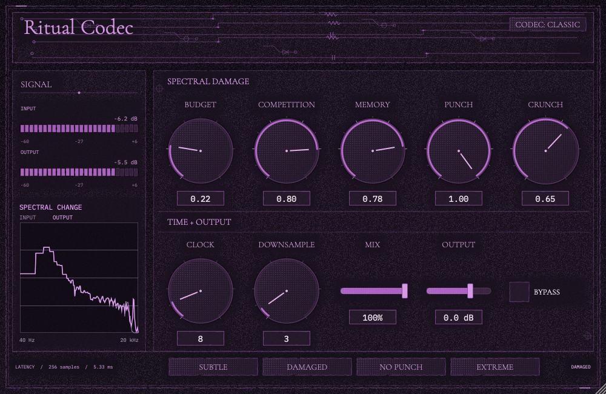
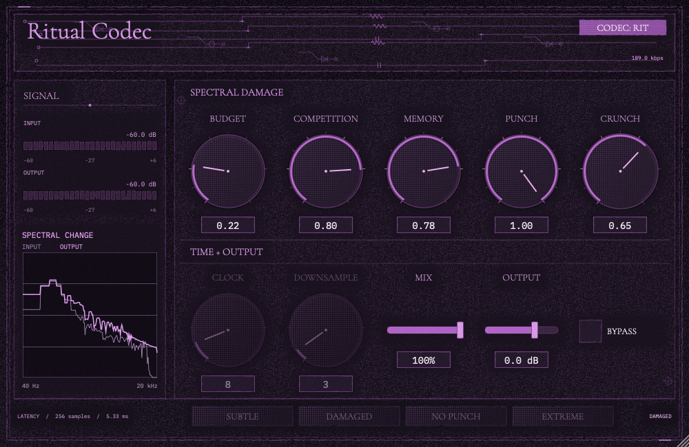
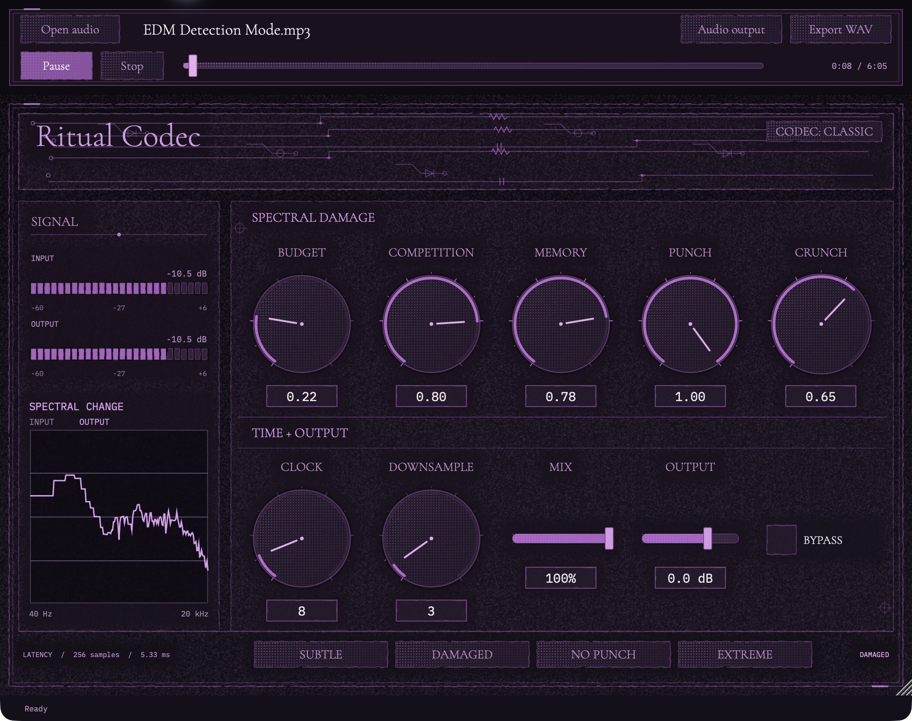

# Interface

Ritual Codec uses purple ink on dark paper: fine circuit traces, engraved
controls, segmented meters and restrained print texture. Labels and values stay
legible. The editor header contains the product name and CODEC mode selector;
the double-ring waveform emblem is reserved for the standalone app icon.



## Typography and controls

Display and parameter lettering use embedded Cormorant Garamond. Numeric
readouts and utility labels use embedded IBM Plex Mono Regular, including editable
values, meters and spectrum labels. Neither font depends on installed system fonts.

Knobs use sparse ticks, an active arc, a pointer and a center cap. Sliders,
presets and bypass share purple surfaces and border treatments. Headings have
separate bands, and control rows leave clearance for value boxes at the minimum
820 × 540 editor size.

JUCE draws the artwork and controls directly. A cached paper texture provides
stable grain rather than random animation during playback. Controls remain live,
resizable and connected to host automation. Latency readouts use the processor's
sample rate.

## RIT mode

RIT shows the actual packet bitrate in the header. Clock, Downsample and Classic
presets are disabled; the other effect controls remain active.



## Spectral feedback

The sidebar shows latency-aligned input and final-output spectra, after mix,
output gain and bypass. Dim purple is input; bright lavender is output. Both
use stereo mean-square energy, avoiding cancellation from opposite-phase channels.
A 1024-point Hann-window FFT runs only on the UI thread at up to 30 updates/s.
The graph spans 40 Hz to the lesser of 20 kHz and Nyquist, and -84 to +6 dBFS.
The display smooths for readability and decays when audio stops. Its low-frequency
resolution is limited by FFT length: 46.875 Hz/bin at 48 kHz.

A fixed-size single-producer/single-consumer queue transfers paired samples.
Queue overflow drops display frames without blocking audio or changing latency.
The graph is an overview of spectral change, not a precision measurement tool.

## Standalone player and icon

The standalone adds file selection, transport, output-device selection and WAV
export around the shared editor. Its buttons, seek bar, fonts and dark framed
surfaces follow the editor theme. Play lights during playback; elapsed and total
time appear beside the scrubber. The audio output dialog uses the same controls.



The 1024-pixel app icon uses the waveform emblem, purple palette and deterministic
noise. Regenerate it with `standalone/assets/generate-icon.swift`.

## Updating the images

Build with tests enabled, then render the current editor using an absolute output
path. The optional audio input populates the meters and spectrum and selects the
Damaged starting point:

```sh
./build/ritual-codec-plugin-test --screenshot /absolute/path/plugin-preview.png 1000 650 /absolute/path/input.wav
./build/ritual-codec-plugin-test --screenshot /absolute/path/plugin-rit-preview.png 1000 650 /absolute/path/input.wav rit
# Minimum-size layout check:
./build/ritual-codec-plugin-test --screenshot /absolute/path/minimum.png 820 540
```

For the standalone image, capture the running app with a credited demo file
playing. Crop only the macOS title bar; retain the full transport, editor and
status area. Avoid file dialogs, private paths and unrelated desktop content.
The checked-in images were refreshed on 2026-10-19 from the current macOS build.
The standalone uses “EDM Detection Mode” by Kevin MacLeod; see
[the attribution](../ATTRIBUTION.md).
